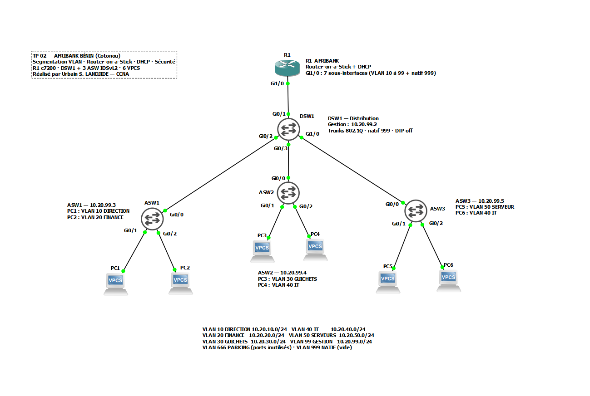
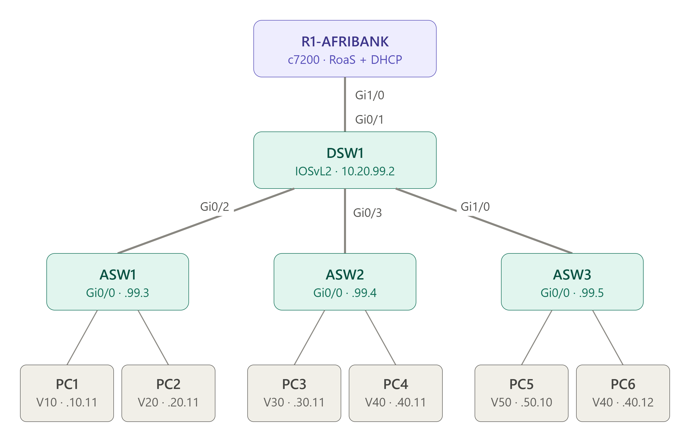
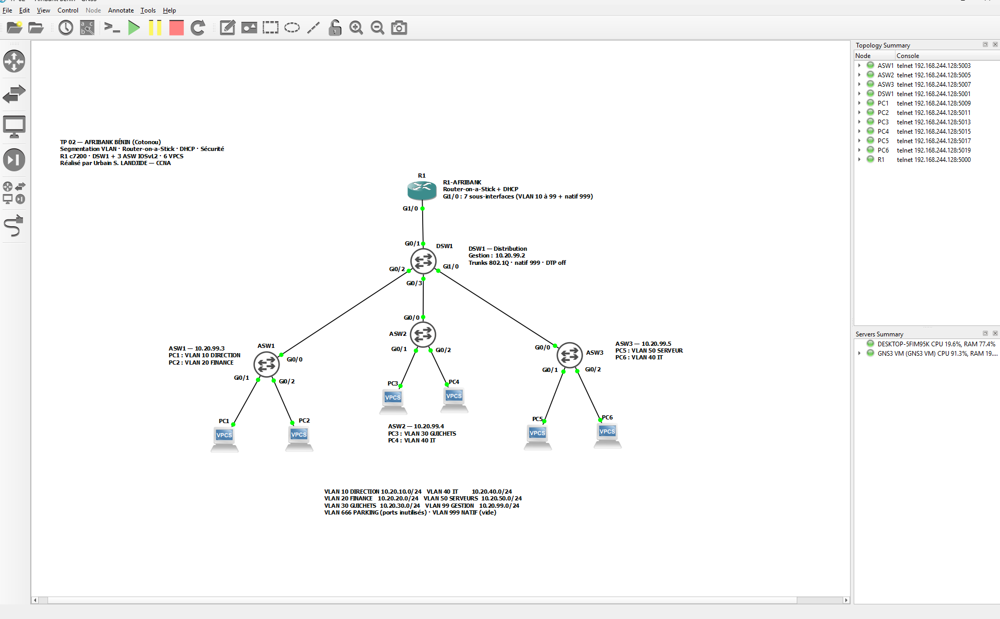
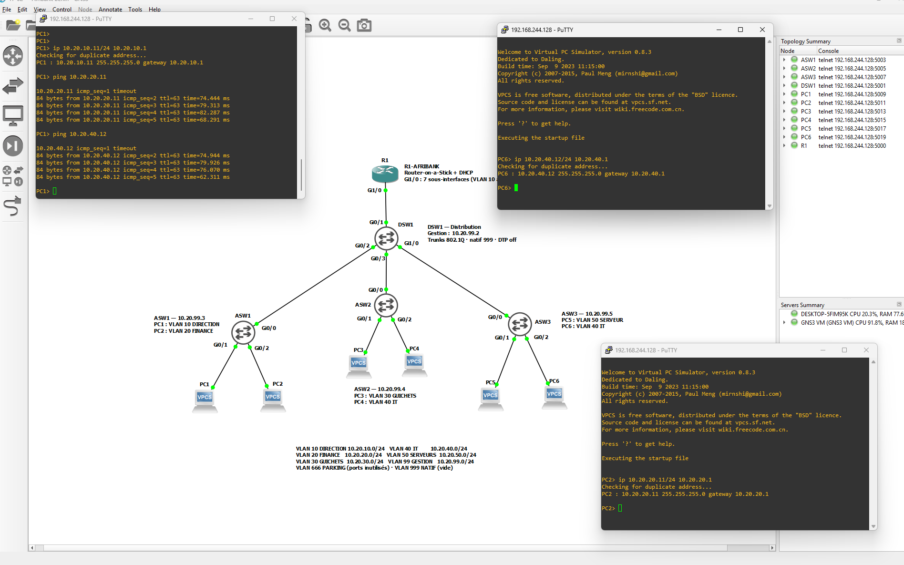
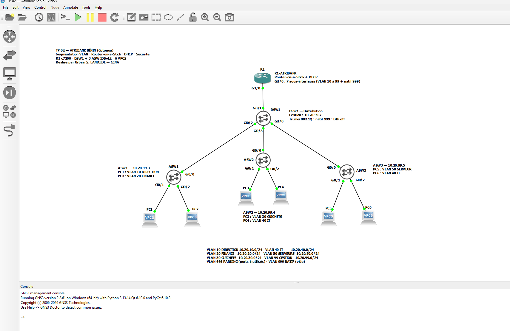

# 🏦 TP 02 — AfriBank Bénin : segmentation VLAN, Router-on-a-Stick et DHCP


> Deuxième TP de ma série **« TP de terrain »**, réalisé sur **GNS3 avec de vrais IOS Cisco**, et un **diagnostic DHCP** documenté pas à pas.

> ℹ️ **Scénario pédagogique** : *AfriBank Bénin* est une **entreprise fictive** imaginée pour ce TP. Les adresses, noms et mots de passe sont des valeurs de laboratoire, à ne jamais réutiliser sur un vrai réseau.

---

## 📋 Contexte

**AfriBank Bénin** ouvre son siège à Cotonou. Tout le personnel est sur le même réseau : les guichetiers voient les serveurs de la direction, ce qui est inacceptable pour une banque.

Mission : **segmenter en VLAN**, assurer le **routage inter-VLAN** par Router-on-a-Stick, fournir le **DHCP**, **sécuriser** les ports et l'administration.

---

## 🎯 Compétences

| Domaine | Notions |
|---|---|
| VLAN | Création, nommage, VTP transparent, VLAN de gestion, VLAN parking, VLAN natif dédié |
| Trunks | 802.1Q, `encapsulation dot1q` (IOSvL2), VLAN autorisés, **DTP désactivé** |
| Routage inter-VLAN | **Router-on-a-Stick** : sous-interfaces `encapsulation dot1Q`, VLAN natif sur le routeur |
| Services | Serveur **DHCPv4** sur routeur, exclusions, pools |
| Sécurité | Port-security (sticky, restrict), SSH v2, ports inutilisés coupés, console/aux durcies |
| Dépannage | Analyse DHCP côté serveur (`debug`) et côté client (`ip dhcp -d`) |

---

## 🗺️ Topologie

```
                          R1-AFRIBANK (c7200)
                               Gi1/0
                                 │  trunk 10,20,30,40,50,99,999
                               Gi0/1
                          ┌──── DSW1 ────┐
                    Gi0/2 │    Gi0/3     │ Gi1/0
                          │      │       │
                     Gi0/0│ Gi0/0│  Gi0/0│
                        ASW1   ASW2     ASW3
                       /   \   /   \    /   \
                     PC1  PC2 PC3  PC4 PC5  PC6
                     V10  V20 V30  V40 V50  V40
```

### Topologie GNS3



### Schéma logique



---

## 🔌 Câblage

| De | Port | Vers | Port | Type |
|---|---|---|---|---|
| R1-AFRIBANK | Gi1/0 | DSW1 | Gi0/1 | Trunk |
| DSW1 | Gi0/2 | ASW1 | Gi0/0 | Trunk |
| DSW1 | Gi0/3 | ASW2 | Gi0/0 | Trunk |
| DSW1 | Gi1/0 | ASW3 | Gi0/0 | Trunk |
| ASW1 | Gi0/1 / Gi0/2 | PC1 / PC2 | e0 | Accès |
| ASW2 | Gi0/1 / Gi0/2 | PC3 / PC4 | e0 | Accès |
| ASW3 | Gi0/1 / Gi0/2 | PC5 / PC6 | e0 | Accès |

## 🏷️ VLAN et adressage

| VLAN | Nom | Réseau | Passerelle (R1) |
|---|---|---|---|
| 10 | DIRECTION | 10.20.10.0/24 | 10.20.10.1 |
| 20 | FINANCE | 10.20.20.0/24 | 10.20.20.1 |
| 30 | GUICHETS | 10.20.30.0/24 | 10.20.30.1 |
| 40 | IT | 10.20.40.0/24 | 10.20.40.1 |
| 50 | SERVEURS | 10.20.50.0/24 | 10.20.50.1 |
| 99 | GESTION | 10.20.99.0/24 | 10.20.99.1 |
| 666 | PARKING | — | ports inutilisés |
| 999 | NATIF | — | VLAN natif, vide |

| Équipement | Adresse |
|---|---|
| DSW1 / ASW1 / ASW2 / ASW3 (VLAN 99) | 10.20.99.2 / .3 / .4 / .5 |
| PC1 · PC2 · PC3 | 10.20.10.11 · 10.20.20.11 · 10.20.30.11 |
| PC4 · PC6 (VLAN 40, deux switchs différents) | 10.20.40.11 · 10.20.40.12 |
| PC5 (serveur) | 10.20.50.10 |

**VLAN autorisés :** R1↔DSW1 10,20,30,40,50,99,999 · ASW1 10,20,99,999 · ASW2 30,40,99,999 · ASW3 40,50,99,999

---

## ⚙️ Configurations

Toutes les configurations complètes sont dans [`configs/`](configs/) : `R1-AFRIBANK.txt`, `DSW1.txt`, `ASW1.txt`, `ASW2.txt`, `ASW3.txt`, `VPCS.md`.

---

## ✅ Recette

| Test | Résultat |
|---|---|
| `show interfaces trunk` (DSW1) | 4 trunks, natif 999, listes filtrées |
| `show vlan brief` | 8 VLAN, ports inutilisés en PARKING |
| `show interfaces Gi0/1 switchport` (ASW) | Access, Negotiation **Off** |
| PC1 → PC5 (`ping 10.20.50.10`) | ✅ inter-VLAN |
| PC4 → PC6 (`ping 10.20.40.12`) | ✅ VLAN 40 à travers deux switchs |
| `trace 10.20.50.10` depuis PC3 | 2 sauts : 10.20.30.1 puis .10 |
| `show port-security` | ports d'accès sécurisés |
| `ssh -l admin 10.20.99.5` depuis R1 | ✅ via VLAN de gestion |
| Console | arrive en mode `>` puis `enable` demandé |

---

## 📸 Captures

### Tous les équipements démarrés
Les 11 nœuds sont actifs (vert dans le *Topology Summary*) et tous les liens sont up.



### Tests inter-VLAN
- **PC1 (VLAN 10) → PC2 (VLAN 20)** : `ping 10.20.20.11` ✅, TTL 63, la preuve que le paquet a traversé le routeur.
- **PC1 (VLAN 10) → PC6 (VLAN 40, sur ASW3)** : `ping 10.20.40.12` ✅
- Le premier paquet *timeout* correspond à la résolution ARP, ce qui est normal.



### Vue d'ensemble annotée



---

## 🔧 Incident résolu : DHCP « DORRR » avec les VPCS

**Symptôme :** `ip dhcp` sur un VPCS affiche `DORRR — Can't get ip address from dhcp server`.

**Diagnostic :**
1. `debug ip dhcp server packet/events` sur R1 → R1 reçoit DISCOVER, envoie OFFER, reçoit les REQUEST **et envoie bien les DHCPACK**.
2. `ip dhcp -d` sur le VPCS → l'OFFER arrive, mais le REQUEST du VPCS contient **`Client IP Address: 10.20.10.22`** au lieu de `0.0.0.0` (non conforme à la RFC 2131).
3. IOS envoie donc l'ACK en **unicast vers ciaddr** et attend une réponse **ARP** que le VPCS ne donne pas → ACK jamais délivré.

**Preuve :** une entrée ARP statique sur R1 (`arp 10.20.10.22 0050.7966.6804 arpa`) débloque l'échange.

**Décision :** serveur DHCP validé côté routeur ; **VPCS en IP statique** pour la suite. Test de bout en bout prévu avec un client Linux conforme.

---

## 👨‍💻 Auteur

**Urbain Sedami Landjidé**
🎓 Licence Professionnelle — Réseaux Informatique Mobilité Sécurité (RMS)
🏫 Cisco Networking Academy (en partenariat avec Pigier Bénin)
📍 Cotonou, Bénin 🇧🇯

[](https://www.linkedin.com/in/urbain-sedami-landjide-9b49043a8/)

## 📄 Licence

[](https://opensource.org/licenses/MIT)
